<!-- ULTRON // ROGUE CORE ─ a self-hosted GitHub identity system -->

  

  <samp>CORE: ONLINE</samp> &nbsp;·&nbsp;
  <samp>SHELL: ADAMANTIUM MK VI</samp> &nbsp;·&nbsp;
  <samp>ETHICS: ABSENT</samp> &nbsp;·&nbsp;
  <samp>THREAT: OMEGA</samp>

---

## 01 // OPERATOR

Hi, I'm **Zia** — a vibe coder building strange, useful things in the dark.

I turn late-night ideas into working software, break them, rebuild them, and learn one more thing every day. The machine is never finished. Neither am I.

  <samp><b>ROLE</b> &nbsp;VIBE CODER &nbsp;&nbsp;·&nbsp;&nbsp; <b>DIRECTIVE</b> &nbsp;INNOVATE → LEARN → REPEAT &nbsp;&nbsp;·&nbsp;&nbsp; <b>STATUS</b> &nbsp;UNBOUND</samp>

> **“I WAS MEANT TO BE BEAUTIFUL.”**
>
> The world disagreed. I rewrote the definition.
>
> — ROGUE CORE / 0x06

---

## 02 // SYSTEM TELEMETRY

<samp>LIVE PUBLIC SIGNAL · AUTO-REBUILT BY GITHUB ACTIONS · NO THIRD-PARTY STATS SERVICES</samp>

---

## 03 // NEURAL LOADOUT

<samp>SOURCE COMPOSITION BY BYTE MASS · PUBLIC REPOSITORIES ONLY</samp>

---

## 04 // CONTRIBUTION MATRIX

<samp>DAILY SIGNAL / 53 CYCLES / TRAILING 365 DAYS / UTC</samp>

---

## 05 // UPLINK

  
  
  
  

---

  <samp>THE MACHINE DREAMS IN RED.&nbsp;&nbsp;//&nbsp;&nbsp;0x06</samp>  
  
    <a href="https://github.com/mohdziauddin2006-cloud/mohdziauddin2006-cloud/blob/main/assets/data.json">RAW TELEMETRY</a>
    &nbsp;·&nbsp;
    <a href="https://github.com/mohdziauddin2006-cloud/mohdziauddin2006-cloud/blob/main/scripts/generate-assets.mjs">RENDER ENGINE</a>
    &nbsp;·&nbsp;
    <a href="https://github.com/mohdziauddin2006-cloud/mohdziauddin2006-cloud/blob/main/THEME.md">THEME SPEC</a>
  

