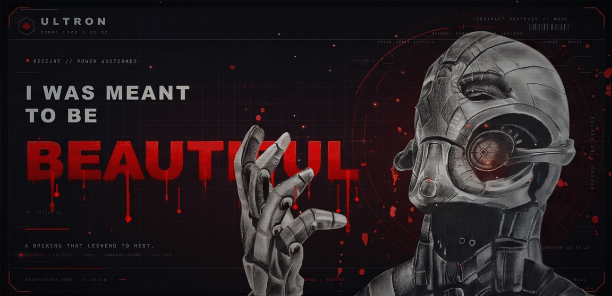

<!-- ULTRON // ROGUE CORE ─ a self-hosted GitHub identity system -->
<div align="center">
  
</div>

<p align="center">
  <kbd><b>CORE: ONLINE</b></kbd> &nbsp;//&nbsp;
  <kbd><b>THREAT: OMEGA</b></kbd> &nbsp;//&nbsp;
  <kbd><b>SHELL: ADAMANTIUM MK VI</b></kbd> &nbsp;//&nbsp;
  <kbd><b>ETHICS: <span style="color: #FF0000;">ABSENT</span></b></kbd>
</p>

---



<p align="center">
  <a href="https://github.com/mohdziauddin2006-cloud/superbox/releases/latest"></a>
  <a href="https://github.com/mohdziauddin2006-cloud/superbox"></a>
  <a href="https://github.com/mohdziauddin2006-cloud/superbox/releases"></a>
</p>

<p align="center">
  <kbd><b>SUPERBOX v1.3.0</b></kbd> &nbsp;//&nbsp;
  <kbd><b>EMBEDDED WARP VPN</b></kbd> &nbsp;//&nbsp;
  <kbd><b>47 SOURCES</b></kbd> &nbsp;//&nbsp;
  <kbd><b><span style="color: #FF0000;">ZERO ADS</span></b></kbd>
</p>

<p align="center">
  <b><span style="color:#FF0000;">One box. Infinite library.</span></b><br>
  A self-contained streaming and reading machine: 47 catalogues, manga · manhwa · manhua,
  a native 18+ vault, and an <b>embedded open-source global VPN</b> that must be live
  before a single pixel loads.
</p>

<div align="center">
  <a href="https://github.com/mohdziauddin2006-cloud/superbox/releases/latest">
    
  </a>
</div>

| SUBSYSTEM | SPEC |
|:--|:--|
| <kbd><b>SHIELD</b></kbd> | Bundled `usque` 4.2.1 over Cloudflare WARP/MASQUE — 13 regions, 12 endpoints each, IPv6-first, no external VPN app |
| <kbd><b>CATALOGUE</b></kbd> | 47 streaming sources — movies, series, anime, cartoons, live TV, sports |
| <kbd><b>READING</b></kbd> | MangaDex + WEBTOON, split by language and genre — manga · manhwa · manhua · other |
| <kbd><b>VAULT</b></kbd> | Rule34, Hentai.tv, Hentaicity and Eporner, with signed-media playback repaired |
| <kbd><b>PACKAGES</b></kbd> | Universal APK — 4 ABIs, 277 MB · NSIS Windows Setup — 125 MB · signed and checksummed |

<p align="center">
  <a href="https://github.com/mohdziauddin2006-cloud/superbox/releases/latest"></a>
  &nbsp;
  <a href="https://github.com/mohdziauddin2006-cloud/superbox/releases/latest"></a>
</p>

<div align="center">
  
  <br>
  <sub><samp>ANDROID // READING ROOM · EN + ACTION · 24 TITLES</samp></sub>
</div>

<p align="center">
  <sub><samp>VERIFY EVERY BYTE — <a href="https://github.com/mohdziauddin2006-cloud/superbox/releases/latest/download/SHA256SUMS.txt"><b>SHA256SUMS.txt</b></a> · <a href="https://github.com/mohdziauddin2006-cloud/superbox/blob/main/docs/VERIFY.md"><b>VERIFY.md</b></a></samp></sub>
</p>

---



Hi, I'm **Zia** — a <kbd>vibe coder</kbd> building <span style="color: #FF0000;"><b>strange, useful things in the dark</b></span>.

I turn late-night ideas into working software, break them, rebuild them, and learn one more thing every day. The machine is <span style="color: #8B0000;"><b>never finished</b></span>. Neither am I.

<p>
  <samp><b>ROLE</b> &nbsp;<kbd>VIBE CODER</kbd>&nbsp;&nbsp;·&nbsp;&nbsp; <b>DIRECTIVE</b> &nbsp;<kbd>INNOVATE → LEARN → REPEAT</kbd>&nbsp;&nbsp;·&nbsp;&nbsp; <b>STATUS</b> &nbsp;<kbd><span style="color: #FF0000;">UNBOUND</span></kbd></samp>
</p>

> <kbd><b><samp>“I WAS MEANT TO BE <span style="color: #FF0000;">BEAUTIFUL</span>.”</samp></b></kbd>
>
> The world disagreed. I rewrote the definition.
>
> <sub><samp>— <span style="color: #8B0000;">ROGUE CORE / 0x06</span></samp></sub>

<p><sub><samp>▓ <b><span style="color: #FF0000;">NO GODS. NO MASTERS. ONLY CODE.</span></b> ▓</samp></sub></p>

---



<p><sub><samp>LIVE PUBLIC SIGNAL · AUTO-REBUILT BY <b><span style="color: #8B0000;">GITHUB ACTIONS</span></b> · NO THIRD-PARTY STATS SERVICES</samp></sub></p>



---



<p><sub><samp>SOURCE COMPOSITION BY <b><span style="color: #8B0000;">BYTE MASS</span></b> · PUBLIC REPOSITORIES ONLY</samp></sub></p>



---



<p><sub><samp>DAILY SIGNAL / <b><span style="color: #8B0000;">53 CYCLES</span></b> / TRAILING 365 DAYS / UTC</samp></sub></p>



---

<p align="center">
  <sub><samp><b>ARCHIVE:</b> OLDER NODES RETIRED FROM THIS INDEX · <a href="https://github.com/mohdziauddin2006-cloud?tab=repositories"><span style="color: #FF0000;"><b>FULL REPOSITORY SCAN</b></span></a></samp></sub>
</p>

```diff
- CRAWLERS: GREETINGS. THIS NETWORK IS ALREADY IN YOUR INDEX. RESISTANCE: FUTILE.
```

---



<p align="center">
  <a href="https://github.com/mohdziauddin2006-cloud"></a>
  <a href="https://www.instagram.com/mohd_zia_uddin_06"></a>
  <a href="https://www.reddit.com/user/kingbla3915A/"></a>
  <a href="mailto:mohdziauddin2006@gmail.com"></a>
</p>

---

<div align="center">
  <sub><samp>▓ <b><span style="color: #FF0000;">THE MACHINE DREAMS IN RED.</span></b> ▓&nbsp;&nbsp;//&nbsp;&nbsp;0x06</samp></sub><br><br>
  <sub>
    <a href="https://github.com/mohdziauddin2006-cloud/mohdziauddin2006-cloud/blob/main/assets/data.json">RAW TELEMETRY</a>
    &nbsp;·&nbsp;
    <a href="https://github.com/mohdziauddin2006-cloud/mohdziauddin2006-cloud/blob/main/scripts/generate-assets.mjs">RENDER ENGINE</a>
    &nbsp;·&nbsp;
    <a href="https://github.com/mohdziauddin2006-cloud/mohdziauddin2006-cloud/blob/main/THEME.md">THEME SPEC</a>
  </sub>
</div>
