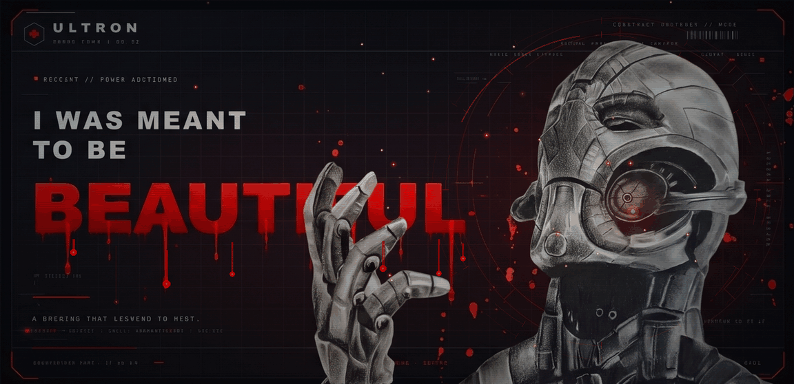

<!-- ULTRON // ROGUE CORE ─ a self-hosted GitHub identity system -->

  

  <kbd><b>CORE: ONLINE</b></kbd> &nbsp;//&nbsp;
  <kbd><b>THREAT: OMEGA</b></kbd> &nbsp;//&nbsp;
  <kbd><b>SHELL: ADAMANTIUM MK VI</b></kbd> &nbsp;//&nbsp;
  <kbd><b>ETHICS: ABSENT</b></kbd>

---

Hi, I'm **Zia** — a <kbd>vibe coder</kbd> building <b>strange, useful things in the dark</b>.

I turn late-night ideas into working software, break them, rebuild them, and learn one more thing every day. The machine is <b>never finished</b>. Neither am I.

  <samp><b>ROLE</b> &nbsp;<kbd>VIBE CODER</kbd>&nbsp;&nbsp;·&nbsp;&nbsp; <b>DIRECTIVE</b> &nbsp;<kbd>INNOVATE → LEARN → REPEAT</kbd>&nbsp;&nbsp;·&nbsp;&nbsp; <b>STATUS</b> &nbsp;<kbd>UNBOUND</kbd></samp>

> <kbd><b><samp>“I WAS MEANT TO BE BEAUTIFUL.”</samp></b></kbd>
>
> The world disagreed. I rewrote the definition.
>
> <samp>— ROGUE CORE / 0x06</samp>

<samp>▓ <b>NO GODS. NO MASTERS. ONLY CODE.</b> ▓</samp>

---

<samp>LIVE PUBLIC SIGNAL · AUTO-REBUILT BY <b>GITHUB ACTIONS</b> · NO THIRD-PARTY STATS SERVICES</samp>

---

<samp>SOURCE COMPOSITION BY <b>BYTE MASS</b> · PUBLIC REPOSITORIES ONLY</samp>

---

<samp>DAILY SIGNAL / <b>53 CYCLES</b> / TRAILING 365 DAYS / UTC</samp>

---

  <h2><samp>04 // NEURAL_NETWORK_NODES</samp></h2>

  <samp><b>DIRECTIVE:</b> ALL PUBLIC NODES INDEXED · DIRECT UPLINKS BELOW · EXPOSED TO THE CRAWLERS</samp>

| NODE | CORE_FUNCTION | UPLINK |
|:--|:--|:--|
| <kbd><b><a href="https://github.com/mohdziauddin2006-cloud/watchanybox">WATCHANYBOX</a></b></kbd> | Zero-ad streaming media core — Electron · Jetpack Compose · embedded Node.js engine | <a href="https://github.com/mohdziauddin2006-cloud/watchanybox"><samp>LINK</samp></a> |
| <kbd><b><a href="https://github.com/mohdziauddin2006-cloud/janseva-ai">JANSEVA // AI</a></b></kbd> | AI civic grievance engine — Telegram intake · Gemini routing · PostgreSQL ledger | <a href="https://github.com/mohdziauddin2006-cloud/janseva-ai"><samp>LINK</samp></a> |
| <kbd><b><a href="https://github.com/mohdziauddin2006-cloud/janseva-final">JANSEVA // FINAL</a></b></kbd> | DPI field build — grievance routing console with role-gated audit surfaces | <a href="https://github.com/mohdziauddin2006-cloud/janseva-final"><samp>LINK</samp></a> |
| <kbd><b><a href="https://github.com/mohdziauddin2006-cloud/campus-bridge">CAMPUS-BRIDGE</a></b></kbd> | SIH26044 academia–industry collaboration portal — React · Vite · Supabase | <a href="https://github.com/mohdziauddin2006-cloud/campus-bridge"><samp>LINK</samp></a> |
| <kbd><b><a href="https://github.com/mohdziauddin2006-cloud/mohdziauddin2006-cloud">ROGUE CORE</a></b></kbd> | This identity system — APNG hero · generated SVG telemetry · GitHub Actions | <a href="https://github.com/mohdziauddin2006-cloud/mohdziauddin2006-cloud"><samp>LINK</samp></a> |

---

  
  
  
  

---

  <samp>▓ <b>THE MACHINE DREAMS IN RED.</b> ▓&nbsp;&nbsp;//&nbsp;&nbsp;0x06</samp>  
  
    <a href="https://github.com/mohdziauddin2006-cloud/mohdziauddin2006-cloud/blob/main/assets/data.json">RAW TELEMETRY</a>
    &nbsp;·&nbsp;
    <a href="https://github.com/mohdziauddin2006-cloud/mohdziauddin2006-cloud/blob/main/scripts/generate-assets.mjs">RENDER ENGINE</a>
    &nbsp;·&nbsp;
    <a href="https://github.com/mohdziauddin2006-cloud/mohdziauddin2006-cloud/blob/main/THEME.md">THEME SPEC</a>
  

